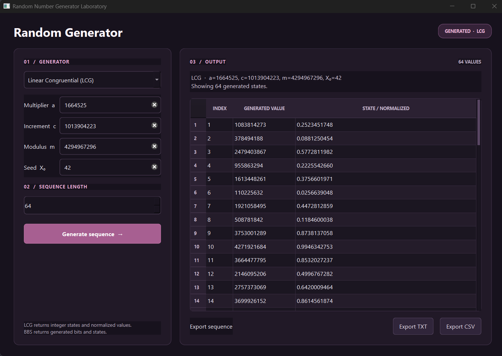
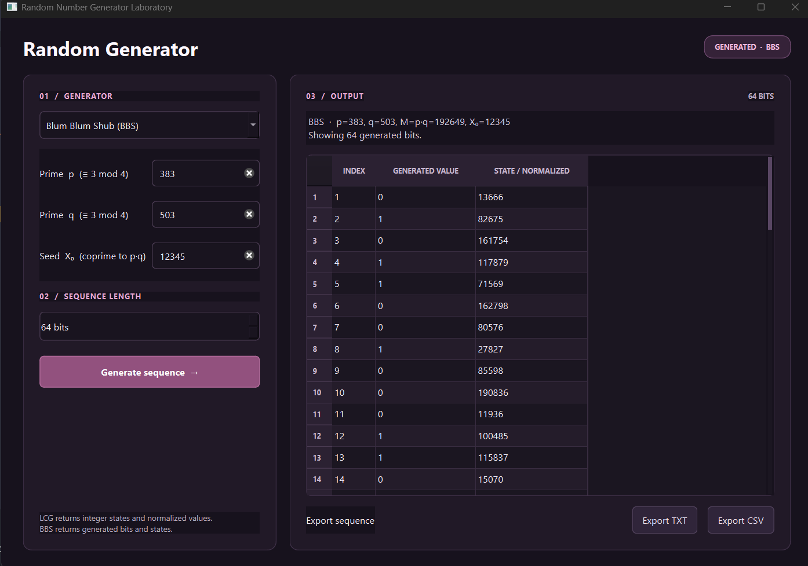

# Random Number Generator Laboratory

Aplicație desktop în Python și PySide6 pentru generarea și inspectarea secvențelor LCG și Blum Blum Shub (BBS). Interfața este în limba engleză, ca în schița funcțională inițială, iar explicațiile de instalare sunt în română.

## Funcționalități

- Selectarea generatorului LCG sau BBS.
- Configurarea parametrilor și lungimii secvenței.
- Validarea domeniului seed-ului pentru LCG și validarea primalității, condiției `3 mod 4`, distinctivității și coprimalității pentru BBS.
- Afișarea valorilor generate; pentru LCG apare și valoarea normalizată `Uₙ = Xₙ / m`, iar pentru BBS se afișează starea internă și bitul rezultat.
- Exportul secvenței în TXT sau CSV.

## Cerințe

- Python 3.10 sau mai nou.
- Windows, macOS sau Linux cu suport Qt.

## Instalare și pornire

Din directorul `RandomGeneratorApp`:

```bash
python -m venv .venv
```

Activează mediul virtual:

```bash
# Windows PowerShell
.venv\Scripts\Activate.ps1

# macOS / Linux
source .venv/bin/activate
```

Instalează dependența și pornește aplicația:

```bash
python -m pip install -r requirements.txt
python main.py
```

## Formulele implementate

**LCG:** `Xₙ₊₁ = (aXₙ + c) mod m`. Tabelul prezintă fiecare stare generată și forma normalizată în `[0, 1)`.

**BBS:** `M = p·q`, `Xₙ₊₁ = Xₙ² mod M`, `Bₙ = Xₙ₊₁ mod 2`. `p` și `q` sunt verificate ca numere prime distincte, congruente cu 3 modulo 4; seed-ul trebuie să fie strict între 1 și `M` și coprim cu `M`.

## Structura

```text
RandomGeneratorApp/
├── main.py
├── algorithms/
│   ├── __init__.py
│   ├── lcg.py
│   └── bbs.py
├── gui/
│   ├── __init__.py
│   └── main_window.py
├── utils/
│   ├── __init__.py
│   ├── export.py
│   └── validation.py
├── requirements.txt
└── README.md
```




